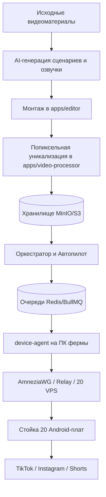

# ЭНЦИКЛОПЕДИЧЕСКИЙ HANDOFF ПРОЕКТА KMMZAVOD
## Полное техническое руководство, архитектура, инфраструктура, разбор багов и регламенты эксплуатации

> **Версия документа:** 2.1 (Сверенная и верифицированная редакция с аудитом кодовой базы)  
> **Дата:** 14 ноября 2026 г.  
> **Статус системы:** Полностью проверенная и верифицированная кодовая база. Закрыты критические уязвимости и архитектурные баги аудита: ликвидированы ложные статусы выгрузки (включая черновики), внедрена защита токенами x-agent-token и x-internal-token, настроен DPI-устойчивый SOCKS5 relay через NL прод-сервер и AmneziaWG, расширена параллельность BullMQ до 24 потоков, автоматизирована безопасная установка TikTok Mod без потери пользовательских сессий.  
> **Репозиторий:** `https://github.com/risimoDev/kmmzavod.git` (ветка `main`)

---

## СОДЕРЖАНИЕ

1. [Обзор системы и бизнес-логика](#1-обзор-системы-и-бизнес-логика)
2. [Архитектура монорепозитория и стек технологий](#2-архитектура-монорепозитория-и-стек-технологий)
3. [База данных и схема Prisma (42 модели)](#3-база-данных-и-схема-prisma)
4. [Конвейер генерации и уникализации видео](#4-конвейер-генерации-и-уникализации-видео)
5. [Оркестратор, очереди BullMQ и Автопилот](#5-оркестратор-очереди-bullmq-и-автопилот)
6. [Физическая телефонная ферма (USB Rack & device-agent)](#6-физическая-телефонная-ферма-usb-rack--device-agent)
7. [Автоматизация UI: TikTok и Instagram (Детальный алгоритм)](#7-автоматизация-ui-tiktok-и-instagram)
8. [Зрительный ИИ-контроль (ai-autopilot.ts)](#8-зрительный-ии-контроль-ai-autopilotts)
9. [Сетевая инфраструктура, ТСПУ/DPI и переход на 20 VPS](#9-сетевая-инфраструктура-тспуdpi-и-переход-на-20-vps)
10. [Проблема «Черновиков» (Drafts) и TikTok Mod](#10-проблема-черновиков-drafts-и-tiktok-mod)
11. [Летопись инцидентов, багов и примененных исправлений](#11-летопись-инцидентов-багов-и-примененных-исправлений)
12. [Операционный регламент (Runbook & Troubleshooting)](#12-операционный-регламент-runbook--troubleshooting)
13. [Полная матрица переменных окружения (.env)](#13-полная-матрица-переменных-окружения-env)
14. [План дальнейшего развития (Roadmap)](#14-план-дальнейшего-развития-roadmap)

---

## 1. ОБЗОР СИСТЕМЫ И БИЗНЕС-ЛОГИКА

**KMMZAVOD** — программно-аппаратный комплекс промышленного класса, созданный для автоматической генерации, модификации (уникализации) и публикации вертикальных видеороликов (Shorts / Reels / TikTok) с использованием физических смартфонов.

### Ключевая концепция:
* **Проблема рынка:** Публикация сотен видеороликов через официальные API или неофициальные web-скрипты быстро приводит к теневым банам (shadowban) и блокировкам за подозрительную активность. Соцсети легко вычисляют эмуляторы, веб-сессии и серверные датацентровые IP.
* **Решение KMMZAVOD:** Реальные физические Android-платы, подключенные через USB к компьютеру фермы, на которых запущены реальные мобильные приложения. Каждое действие (клики, ввод текста, свайпы) эмулирует поведение человека, а сетевой трафик каждой платы изолирован в собственный защищенный канал с выделенным IP.



---

## 2. АРХИТЕКТУРА МОНОРЕПОЗИТОРИЯ И СТЕК ТЕХНОЛОГИЙ

Проект организован на базе **Turborepo** и пакетного менеджера **pnpm**.

### Структура пакетов и приложений:

```
kmmzavod/
├── apps/
│   ├── web/               # Next.js 14 App Router, React 18, Tailwind CSS, Radix UI / Shadcn
│   ├── api/               # Fastify 4, TypeScript, Zod, Prisma Client, JWT, Swagger
│   ├── orchestrator/      # Node.js, BullMQ, Redis (IORedis), Prisma Client, Axios
│   ├── device-agent/      # Node.js, Fastify, ADB Kit / Native ADB CLI, sing-box, Axios
│   ├── editor/            # Python 3.11, FastAPI, MoviePy, FFmpeg, Whisper / Faster-Whisper
│   └── video-processor/   # Python 3.11, FastAPI, OpenCV, FFmpeg, PyTorch, Librosa
├── packages/
│   ├── db/                # Prisma ORM, PostgreSQL схема, миграции, сиды (@kmmzavod/db)
│   ├── queue/             # Типизированные очереди BullMQ, Redis коннекторы (@kmmzavod/queue)
│   ├── storage/           # S3 / MinIO SDK обертка с поддержкой presigned URLs (@kmmzavod/storage)
│   └── ai/                # Клиенты OpenRouter, Claude, OpenAI, Fish Audio (@kmmzavod/ai)
└── scripts/               # Скрипты инфраструктуры, автоустановки и деплоя
```

### Назначение сервисов и порты:

| Сервис | Порты (Docker / Dev) | Стек | Роль в системе |
| :--- | :--- | :--- | :--- |
| **`web`** | 3001 (Docker) / 3000 (Dev) | Next.js (App Router) | Панель управления, дашборд автопилота, видеоредактор, мониторинг плат. Наружу через Nginx 80/443. |
| **`api`** | 3000 (Docker) / 8000 (Dev) | Fastify, TS | Главный REST API, аутентификация, валидация DTO, работа с БД. Наружу через Nginx `/api`. |
| **`orchestrator`** | — (фоновый сервис) | Node.js, BullMQ | Фоновые очереди (concurrency: 24), воркеры, стейт-машина автопилота (`loop.ts`). |
| **`device-agent`** | 8300 (только localhost / туннель) | Fastify, Node.js | Локальный сервис на ПК фермы. Контролирует ADB, прокси, платы. Защищен токеном `x-agent-token`. |
| **`editor`** | 8001 | Python, FastAPI | Нарезка исходников, сборка таймлайна, озвучка, субтитры. Защищен `x-internal-token`. |
| **`video-processor`**| 8002 | Python, FastAPI | Уникализация: метаданные, шум, аудиопитч, геометрия кадра. Защищен `x-internal-token`. |

---

## 3. БАЗА ДАННЫХ И СХЕМА PRISMA

База данных работает на **PostgreSQL 15+**. Схема содержит **42 взаимосвязанные модели** (`packages/db/prisma/schema.prisma`).

### Ключевые сущности:

1. **Мультитенантность и пользователи:**
   * `Tenant` — сущность организации/команды.
   * `User`, `UserSession` — пользователи с ролевой моделью (`owner`, `admin`, `member`).
   * `BillingPlan`, `TenantBillingPlan`, `CreditTransaction`, `UsageRecord` — биллинг и учет ресурсов.

2. **Видеопроизводство:**
   * `SourceVideo` — оригинальные загруженные видеоматериалы (raw footage).
   * `EditProject`, `EditSource`, `EditClip` — проекты монтажа, нарезка клипов, таймлайн.
   * `TenantVoice` — голоса Fish Audio (ID спикера, параметры скорости и эмоциональности).
   * `Video` — смонтированное мастер-видео.
   * `UniquifyJob`, `UniqueVariant` — варианты уникализации мастер-видео с выходными S3-ключами.

3. **Ферма и социальные аккаунты:**
   * `SocialAccount` — привязанный аккаунт соцсети (`tiktok`, `instagram`, `youtube_shorts`). Поля: `deviceId` (серийный номер платы ADB), `authMethod` (`device` | `private` | `official`), `proxyId`, `warmupStatus`, `healthScore`.
   * `Proxy` — пул прокси-серверов с типами (`socks5`, `http`, `residential`, `mobile`).
   * `AccountGroup` — группы аккаунтов для распределения задач (с полем `maxPostsPerDay`).

4. **Публикация и Автопилот:**
   * `PublishJob` — единичная задача выгрузки ролика на аккаунт. Хранит статус (`pending`, `scheduled`, `uploading`, `published`, `failed`), ошибки, заголовок, хештеги.
   * `DistributeJob`, `DistributeItem` — партии распределения роликов по аккаунтам (`DistributeItemStatus`: `pending`, `scheduled`, `publishing`, `published`, `failed`, `skipped`).
   * `Autopilot` — конфигурация расписания и правил автопилота: `publishTimes` (список окон, например `["09:30", "14:00", "19:30"]`), `jitterMinutes`, статус (`active`, `paused`).
   * `AutopilotRun`, `AutopilotBatch` — история прогонов и генерации партий автопилота.
   * `PostMetric` — сбор просмотров, лайков, репостов с профилей.

---

## 4. КОНВЕЙЕР ГЕНЕРАЦИИ И УНИКАЛИЗАЦИИ ВИДЕО

### Этап 1: Генерация сценария (`gpt-script.worker.ts`)
* Воркер вызывает `@kmmzavod/ai` (OpenRouter API с моделями Claude 3.5 Sonnet или GPT-4o).
* По карточке продукта формируется сценарий, состоящий из 3 блоков:
  1. **Hook (0-3 сек):** Визуальный и речевой хук для удержания внимания.
  2. **Body (3-20 сек):** Демонстрация проблемы и решения через продукт.
  3. **Call-to-Action (20-25 сек):** Призыв к действию (переход в профиль, покупка на маркетплейсе).

### Этап 2: Синтез речи (Fish Audio)
* Текст отправляется в Fish Audio API с указанием `reference_id` голоса.
* Полученный аудиофайл сохраняется в S3/MinIO.

### Этап 3: Монтаж (`apps/editor`)
* Микросервис на Python производит точную нарезку исходников:
  * Анализ тишины и транскрибация речи (Whisper).
  * Выравнивание аудиодорожки со сценарием (`script_align.py`).
  * Генерация динамических анимированных субтитров с пословным выделением (`subtitle.py`).
  * Финальный рендер через MoviePy/FFmpeg с кодеком H.264 (NVENC или libx264).

### Этап 4: Попиксельная уникализация (`apps/video-processor`)
Для каждой из 17–20 копий видеоролика воркер `uniquify-render.worker.ts` обращается к сервису `video-processor`:
1. **Визуальные искажения:**
   * Случайный микрозум кадра (101% – 103%).
   * Легкий сдвиг цветового баланса (Color Grading / Gamma shift на 1-2%).
   * Наложение невидимого высокочастотного шума в цветовые каналы.
2. **Аудио-модификации:**
   * Микро-сдвиг высоты тона (Pitch Shift на 0.2–0.5 полутона) без изменения скорости.
   * Наложение неслышимого фонового шума в паузах.
3. **Файловая уникализация:**
   * Полная очистка всех метаданных контейнера (удаление EXIF, XMP, информации о ПО рендера).
   * Добавление случайного мусорного паддинга в конец файла, полностью изменяющее контрольную сумму MD5/SHA256.

---

## 5. ОРКЕСТРАТОР, ОЧЕРЕДИ BULLMQ И АВТОПИЛОТ

### Архитектура очередей BullMQ:
Все задачи проходят через Redis (`REDIS_URL`) с гарантией доставки:

* `autopilot-produce`: Мониторинг буфера готовых копий. Если буфер ниже нормы — ставит задачи на монтаж и уникализацию.
* `editor-render`: Очередь монтажа мастер-роликов.
* `uniquify-render`: Очередь массовой уникализации под каждую плату.
* `uniquify-distribute`: Распределение готовых уникальных копий по слотам аккаунтов.
* `publish`: Выгрузка ролика на телефонную плату через `device-agent` (**`concurrency: 24`**, обеспечивающий параллельную выгрузку всех 20 плат без очередей).
* `account-warmup`: Прогрев аккаунтов (просмотр целевых видео, лайки, скролл).

### Стейт-машина Автопилота (`apps/orchestrator/src/autopilot/loop.ts`):
1. **Тик цикла (каждые 60 сек):** Функция `runAutopilotsTick` находит все автопилоты со статусом `active`.
2. **Расчет временных окон:** `computeNextWindow` анализирует заданные часы (например, `09:30, 14:00, 19:30`) и добавляет случайный джиттер (`jitterMinutes`), чтобы публикации не происходили в одну и ту же секунду.
3. **Отбор аккаунтов (`eligibleAccounts`):**
   * Рассчитывает лимит публикаций в сутки на основе настроек группы аккаунтов (`group.maxPostsPerDay`) и количества запланированных окон.
   * Контролирует интервалы между постами аккаунта, отсекая повторные бронирования незавершенных задач.
   * Исключает отключенные аккаунты (`isActive: false`) и аккаунты с низким рейтингом здоровья (`healthScore < 30`).
4. **Управление параллелизмом в `publish.worker.ts`:**
   * Захватывает мьютекс платы `lock:device:<deviceId>`.
   * Проверяет режим прокси (`deviceAgentService.getProxyMode()`).
     * В режиме `shared_sequential`: захватывает общий замок фермы `farm:shared-proxy` (публикация по очереди с безопасной паузой).
     * В режиме `private_parallel`: общий замок **НЕ захватывается**, все 20 плат выкладывают видео **одновременно** без искусственных линейных задержек (stagger), с рандомизированным джиттером 0–60 сек.
5. **Мульти-устройственный живой прогресс:**
   * Прогресс шагов выгрузки пишется в Redis Hash `autopilot:live:<id>` по ключу `deviceId` (`HSET`), что полностью исключает затирание прогресса параллельно работающих плат.
   * API (`/autopilot/:id`) считывает все активные задачи фермы и транслирует их в UI дашборда.

---

## 6. ФИЗИЧЕСКАЯ ТЕЛЕФОННАЯ ФЕРМА (USB RACK & DEVICE-AGENT)

### Специфика аппаратной среды:
* Стойка на 20 плат смонтирована на специализированном шасси с принудительным охлаждением.
* Питание плат осуществляется от мощного промышленного блока питания 5V (2-3A на плату).
* Подключение данных идет через экранированные USB-кабели в активные промышленные USB-хабы с чипсетами Genesys Logic или Realtek.
* На хосте Windows развернут Google Android Platform Tools (`adb.exe`).

### Устройство `apps/device-agent`:
`device-agent` — автономный демон на Fastify (порт 8300), управляющий устройствами через нативные вызовы ADB CLI:

1. **Монитор устройств (`adb-client.ts`):** 
   * Периодический опрос `adb devices -l`.
   * Фильтрация устройств по статусу `device` (отсечение `unauthorized` и `offline`).
2. **Прокси-менеджер (`proxy-manager.ts`):**
   * Хранит конфигурацию в `devices-proxy-state.json`.
   * Запускает локальный пул слушателей `DeviceProxyListener` на портах 18800..18820.
   * Пробрасывает порты на каждую плату через `adb -s <serial> reverse tcp:8888 tcp:<listenPort>`.
   * На платах выставляется системный прокси: `settings put global http_proxy 127.0.0.1:8888`.
   * Для плат с root-доступом служба `root-proxy.ts` управляет бинарником `sing-box` на Android, заворачивая весь TCP-трафик через правила `iptables`.
3. **Авто-восстановление (`auto-heal.ts`):**
   * Watchdog каждые 15 секунд проверяет целостность `adb reverse` и процессов прокси.
   * При перезагрузке платы или сбросе USB-порта демон автоматически восстанавливает сетевое окружение без участия оператора.

---

## 7. АВТОМАТИЗАЦИЯ UI: TIKTOK И INSTAGRAM

Автоматизация выгрузки (`apps/device-agent/src/publish.ts` и `publish-flow.ts`) построена на надежной конечной автоматной машине (State Machine).

### Пошаговый сценарий выгрузки в TikTok:

```
[1. Передача файла] ──► adb push video.mp4 /sdcard/DCIM/Camera/
         │
[2. Регистрация]    ──► am broadcast MEDIA_SCANNER_SCAN_FILE (появление в Галерее)
         │
[3. Старт клиента]  ──► am start com.zhiliaoapp.musically (открытие TikTok)
         │
[4. Кнопка Создать] ──► Поиск кнопки "+" (lwh, create, tab_publish)
         │
[5. Выбор ролика]   ──► Вкладка "Видео", тап по 1-й плитке в сетке
         │
[6. Экран редактора]──► Пропуск эффектов, тап кнопки "Далее" (Next)
         │
[7. Экран описания] ──► Ввод заголовка и хештегов в поле desc
         │
[8. Скрытие клавиш] ──► input keyevent 111 (Escape) — НЕ закрывает экран!
         │
[9. Кнопка Пост]    ──► Тап кнопки "Опубликовать" (Publish/Post/Поделиться)
         │
[10. Верификация]   ──► Открытие Профиля, сверка счетчика видео (СТРОГО!)
         │
[11. Очистка]       ──► Удаление видеофайла ТОЛЬКО при успехе
```

### Детали реализации критических шагов:

1. **Доставка видео в Галерею:**
   Файл загружается через ADB напрямую в `/sdcard/DCIM/Camera/<unique_name>.mp4`. Сразу после загрузки вызывается системный бродкаст:
   `adb shell am broadcast -a android.intent.action.MEDIA_SCANNER_SCAN_FILE -d file:///sdcard/DCIM/Camera/<name>.mp4`
   Это гарантирует мгновенное появление видео в топе галереи TikTok без перезагрузки платы.

2. **Защита от ложных срабатываний кнопки «Опубликовать»:**
   * В `publish-flow.ts` функция `findPostButton` исключает любые кнопки с идентификаторами `NEXT`, `NEXT_ID` (`clips_right_action_button`), а также кнопки нижней системной навигации (`TT_HOME_NAV`).
   * Кнопка публикации определяется строго по сочетанию признаков: текст («Опубликовать», «Поделиться», «Publish», «Post»), класс `android.widget.Button` и позиция в нижней трети экрана.

3. **Скрытие клавиатуры:**
   Категорически запрещено использовать `keyevent 4` (Back), так как на многих прошивках Android нажатие Back при открытом экране публикации закрывает весь активити и сбрасывает ролик в черновики. Используется код `111` (Escape), который только деактивирует soft keyboard.

4. **Строгая верификация выгрузки (`profileVerified`):**
   * После нажатия кнопки скрипт ждет до 60–90 секунд прогресса выгрузки.
   * Затем принудительно переходит на вкладку «Профиль» (`adb.openApp` или тап по иконке профиля).
   * Считывает количество опубликованных видеоплиток через `parseCount` в `profile-stats.ts`.
   * Если счетчик увеличился — статус выгрузки помечается как `ok: true`.
   * Если на профиле обнаружена плашка «Черновики» (Drafts), активируется автоматическая процедура восстановления: `recoverAndPublishDraft`.

---

## 8. ЗРИТЕЛЬНЫЙ ИИ-КОНТРОЛЬ (AI-AUTOPILOT.TS)

Если соцсеть обновила интерфейс, изменила `resource-id` или показала неожиданный системный диалог (например, «Разрешить доступ к фото?», «Новые правила сообщества», капча), стандартный парсер XML может зайти в тупик.

Для этого в `device-agent` внедрен модуль **нейросетевого зрения**:

1. **Триггер:** 3 последовательных нераспознанных экрана (`unknown >= 3`), что исключает ложные и дорогостоящие срабатывания на переходных анимациях или кратковременных задержках отрисовки.
2. **Снятие снимка:** `adb exec-out screencap -p` делает мгновенный скриншот экрана.
3. **Запрос к Vision LLM:** Снимок анализируется через ClaudeHub API (`api.claudehub.fun`) с моделями Gemini Flash 3.8 / Claude Haiku 3.5 со строгим системным промптом:
   * Задача ИИ: закрыть диалог, отклонить запрос разрешений, нажать «Далее» или выбрать целевой формат.
   * ИИ возвращает тип действия (`tap`, `tap_draft`, `retry_network`, `require_human`) и целевой текст либо относительные координаты.
4. **Масштабирование и клампинг координат (`parseAiCoordinates`):**
   * Координаты валидируются и приводятся к физическим пикселям экрана платы из любой шкалы: нормализованной (0..1), относительной (0..1000) или абсолютной.
   * Применяется жесткий клампинг `[0, width - 1]` и `[0, height - 1]`, исключающий промахи и вылеты за границы экрана.
5. **Защита от двойной публикации (H6):**
   * Все регулярные выражения для поиска элементов на экране экранируются через хелпер `escapeRegExp` (спецсимволы в тексте ответа модели не роняют скрипт).
   * Если ИИ тапает кнопку публикации («Опубликовать», «Поделиться», «Post»), флаг `st.shareTapped` немедленно выставляется в `true`, а статус выгрузки переводится в `posted = 'unknown'`. Это исключает повторный запуск задачи воркером BullMQ.
6. **Сохранение отладки:** Спорные кадры и XML-дампы экрана сохраняются в локальный каталог платы `/sdcard/kmm-debug` для последующего аудита.

---

## 9. СЕТЕВАЯ ИНФРАСТРУКТУРА, ТСПУ/DPI И ПЕРЕХОД НА 20 VPS

### Анатомия блокировок ТСПУ в России:
Технические средства противодействия угрозам (ТСПУ) установлены на сетях всех магистральных провайдеров РФ. Они осуществляют глубокий анализ пакетов (DPI):
* **Почему голый SOCKS5 не работает:** Первые байты рукопожатия протокола SOCKS5 (`05 01 02` — версия 5, 1 метод, парольная аутентификация) абсолютно прозрачны и имеют уникальную сигнатуру. ТСПУ на трансграничном стыке моментально определяет этот заголовок и отправляет сброс соединения (TCP RST) или сбрасывает скорость до нуля.
* **Почему AstroProxy сжег $35:** Мобильные и резидентские прокси продаются с оплатой за каждый гигабайт. Постоянная передача тяжелых видеофайлов (15–30 МБ на копию) быстро съедает десятки долларов, а общая точка выхода создавала бутылочное горлышко.

### Новая топология: 20 VPS через AmneziaWG-туннель и NL Relay (DPI-Safe)

```
[ПК фермы (РФ)] 
      │
      ▼ (AmneziaWG: обфусцированный WireGuard, полный иммунитет к ТСПУ)
[Главный прод-сервер (Нидерланды, 10.66.66.1)]
      │
      ├─► (iptables DNAT: порт 11001) ──► [VPS #1:1080]  ──► IP #1 (TikTok)
      ├─► (iptables DNAT: порт 11002) ──► [VPS #2:1080]  ──► IP #2 (TikTok)
      │   ...
      └─► (iptables DNAT: порт 11020) ──► [VPS #20:1080] ──► IP #20 (TikTok)
```

### Порядок настройки 20 VPS и релея:
1. **Покупка VPS:** 20 минимальных виртуалок (1 vCPU, 512MB–1GB RAM, Ubuntu 22.04) у недорогих европейских хостеров (Aeza, Timeweb Cloud, Vdsina, PQ.Hosting). Средняя цена: 150–190 ₽/мес ($1.8) за сервер.
2. **Установка защищенного прокси на каждом VPS:** Запускается скрипт [`scripts/vps-setup-proxy.sh`](file:///c:/Projects/kmmzavod/scripts/vps-setup-proxy.sh) с указанием внешнего IP NL прод-сервера (`ALLOW_IP`):
   ```bash
   sudo bash vps-setup-proxy.sh 1080 kmmuser СЕКРЕТНЫЙ_ПАРОЛЬ <PROD_PUBLIC_IP>
   ```
   * Скрипт настраивает файрвол UFW и Dante так, что трафик разрешен **только с IP прод-сервера**.
   * Запрещается вход по SSH для прокси-пользователя (`DenyUsers`).
   * Разрешена только команда `connect` (UDP и `bind` отключены).
3. **Настройка проброса на прод-сервере (Нидерланды):**
   * Запускается скрипт [`scripts/prod-setup-proxy-relay.sh`](file:///c:/Projects/kmmzavod/scripts/prod-setup-proxy-relay.sh) со списком купленных VPS.
   * Скрипт включает IPv4-форвардинг, настраивает `iptables DNAT` с портов `11001..11020` внутри туннеля AmneziaWG на внешние порты 20 VPS, и генерирует готовый файл конфигурации `vps-proxies-tunnel.txt`.
4. **Привязка к стойке плат (ПК фермы):**
   * Список строк `10.66.66.1:1100X:USER:PASS` копируется в `apps/device-agent/vps-proxies.txt` (или в формате `SERIAL=...`).
   * Запускается скрипт [`apps/device-agent/apply-vps-proxies.ps1`](file:///c:/Projects/kmmzavod/apps/device-agent/apply-vps-proxies.ps1).
   * Скрипт проверяет все платы, проводит гео-проверку `batch-check` (отсекая утечки российских IP), и переключает стойку в режим **`private_parallel`** с политикой `inactivePolicy: block`.

---

## 10. ПРОБЛЕМА «ЧЕРНОВИКОВ» (DRAFTS) И TIKTOK MOD

### Механика внутренней блокировки ByteDance:
В марте 2022 года TikTok ограничил загрузку видео для пользователей из России. 
Алгоритм проверки в официальном клиенте:
1. Приложение вызывает Android API `TelephonyManager.getSimCountryIso()`, `getNetworkCountryIso()`, `getSimOperator()`.
2. Если код оператора начинается с `250` (Россия: МТС, Мегафон, Билайн, Т2), TikTok активирует внутренний режим блокировки.
3. Даже если подключен зарубежный прокси/VPN, кнопка «Опубликовать» не отправляет видео на сервер, а перенаправляет поток в локальную базу данных SQLite (`draft_db`). Видео сохраняется в папку «Черновики» внутри смартфона. Веб-версия TikTok на ПК показывает 0 роликов.

### Решение через TikTok Mod:
* **Что делает мод:** Модифицированные клиенты (сборки BReaaker, Дмитрия Нечипоренко на базе версий 34.x–36.x с плагином TikTok Plugin) перехватывают системные вызовы и подменяют MCC/MNC на зарубежные (США — `310`, Германия — `262`).
* **Результат:** Приложение считает, что находится за пределами РФ. Видеоролики публикуются в публичный CDN и мгновенно появляются в ленте рекомендаций.

### Автоматическая безопасная установка через скрипт (C5):
В репозитории подготовлен безопасный инструмент [`apps/device-agent/install-tiktok-mod.ps1`](file:///c:/Projects/kmmzavod/apps/device-agent/install-tiktok-mod.ps1):
* Скачанные APK мода и плагина помещаются в `apps/device-agent/apks/`.
* **Сохранение сессий:** Из скрипта удален безусловный `pm clear`, который сбрасывал авторизацию всех аккаунтов. Флаг `-WipeData` вызывается только при явной необходимости.
* **Предварительный тест:** Скрипт проверяет установку на первом устройстве. Если версия мода подписана другим ключом разработчика (`INSTALL_FAILED_UPDATE_INCOMPATIBLE`), скрипт выводит предупреждение и останавливается, не повреждая остальные платы.
* Устанавливает APK на платы с ключами `-r -d -g` (обновление с сохранением данных и авто-выдачей разрешений).
* Выдает права доступа к медиафайлам и отключает энергосбережение: `dumpsys deviceidle whitelist +com.zhiliaoapp.musically`.

---

## 11. ЛЕТОПИСЬ ИНЦИДЕНТОВ, БАГОВ И ПРИМЕНЕННЫХ ИСПРАВЛЕНИЙ

В ходе тестирования и комплексного аудита архитектуры фермы был выявлен и устранен ряд сложных архитектурных багов и уязвимостей:

| Инцидент / Ошибка | Первопричина | Файл и исправление |
| :--- | :--- | :--- |
| **Ложный статус «Published»** для 47 постов при 0 видео в веб-профиле | `publish.ts` считал возврат на `MainActivity` успехом, не проверяя профиль. | Введена жесткая верификация счетчика видео (`profileVerified`) в `publish.ts`. |
| **Ложный успех через восстановление черновиков (C2)** | `recoverAndPublishDraft` возвращал `ok: true, posted: 'yes'` при любом нажатии «Опубликовать». | В `recoverAndPublishDraft` передан `baseline` профиля, успех фиксируется **только** при реальном росте счетчика на профиле (`isNewPostOnProfile`). |
| **Уязвимость открытого device-agent без авторизации (C1)** | Демон слушал `0.0.0.0` и не валидировал токен `AGENT_TOKEN`. | Привязка строго к IP туннеля/localhost, проверка `x-agent-token` через `timingSafeEqual`, лимит JSON body до 2 МБ. |
| **Риск повторной публикации при «Перезапустить упавшие» (C3)** | Роут брал все `failed` и `skipped`, сбрасывая даже неподтвержденные задачи. | Отсечены неподтвержденные посты (`posted: 'unknown'`) и `skipped`, декрементируются счетчики ошибок, атомарная постановка в BullMQ. |
| **Сбой PowerShell `$host` в `apply-vps-proxies.ps1` (C4)** | `$Host` — системная read-only переменная PowerShell. | Переменные переименованы в `$pHost`, `$pPort`, включен `Set-StrictMode`, жесткая привязка `SERIAL=IP:PORT`, политика `inactivePolicy: block`. |
| **Стирание сессий при установке TikTok Mod (C5)** | Безусловный `pm clear` удалял авторизацию всех аккаунтов. | `pm clear` удален, добавлен безопасный ключ `-WipeData` (по умолчанию `false`), предварительный тест на первой плате. |
| **Бутылочное горлышко очереди: 2 задачи вместо 20 (C6)** | `publish.concurrency = 2` и линейный stagger по 3 мин на плату. | `concurrency` поднят до 24, для `private_parallel` линейный stagger заменен на параллельный запуск с микро-джиттером (0-60 с). |
| **Дублирование BullMQ-задач при watchdog (H1-H2)** | Случайные `bullJobId` плодили задачи в очереди при живых процессах. | Внедрен детерминированный `jobId: publishJobId`, проверка статусов (`active`/`delayed`), вызов `settleDistributeItem`. |
| **Штрафование аккаунтов с низким health на паузе (H3)** | Воркер бросал обычный `Error` и снимал −20 здоровья с аккаунтов на паузе. | Ошибки помечены как `UnrecoverableError`, `INFRA_ERROR_RE` расширен, аккаунты на паузе не штрафуются. |
| **Зависание отмененной раздачи в `publishing` (H4)** | Статус `DistributeItem` обновлялся до проверки отмены родительской задачи. | Проверка отмены перенесена в самое начало воркера с вызовом `finalizePublishFailure`. |
| **Сгорание уникальных копий при пропуске (H5)** | Фильтр `distributeItems: { none: {} }` сжигал варианты навсегда. | Фильтр обновлен: `{ none: { status: { not: 'skipped' } } }`, неиспользованные копии возвращаются в пул. |
| **Сбои регулярных выражений и тапов ИИ-советника (H6)** | Неэкранированный `RegExp`, отсутствие масштабирования координат. | Внедрены `escapeRegExp`, `parseAiCoordinates` (с клампингом), авто-перевод в `st.shareTapped` при тапе по кнопке публикации. |
| **Рассинхронизация таймаутов оркестратора и агента (H7)** | Оркестратор ждал 20 мин, а агент мог зависать дольше при циклах проверок. | В `publishToDevice` внедрен жесткий дедлайн 14 минут, оркестратор ждет с 6-минутным запасом. |
| **Коллизия живого прогресса в Redis для 20 плат (H8)** | Все платы писали в один строковый ключ `autopilot:live:<id>`. | Переведено на Redis Hash `HSET autopilot:live:<id> <deviceId> <json>`, UI получает состояние всех плат фермы. |
| **Блокировка SOCKS5 со стороны ТСПУ и открытый Dante (H9-H10)** | Открытый порт Dante и прямые SOCKS5-запросы с ПК фермы резались ТСПУ. | Разработан `prod-setup-proxy-relay.sh` (проброс через AmneziaWG) и защита Dante через `ALLOW_IP`. |

---

## 12. ОПЕРАЦИОННЫЙ РЕГЛАМЕНТ (RUNBOOK & TROUBLESHOOTING)

### Ежедневный запуск фермы (ПК Windows):
1. Убедиться, что USB-хабы включены и платы запитаны.
2. Открыть консоль PowerShell от имени Администратора:
   ```powershell
   cd c:\Projects\kmmzavod\apps\device-agent
   # Проверка доступности плат:
   adb devices -l
   # Должно быть 17-20 устройств со статусом "device"
   ```
3. Запустить службу агента:
   ```powershell
   npm run dev
   # Или через готовый батник:
   .\start-farm.bat
   ```
4. Убедиться, что в логах появилось: `proxy-manager: proxies restored, mode: private_parallel`.

### Что делать, если плата ушла в оффлайн (`offline` / `unauthorized`):
1. Перезапустить ADB-сервер:
   ```powershell
   adb kill-server
   adb start-server
   ```
2. Если конкретная плата висит в `offline`, программно перезагрузить ее порт через USB-концентратор или выполнить:
   ```powershell
   adb -s <SERIAL> reconnect
   ```

### Что делать, если видео не выкладываются и копятся в черновиках:
1. Запустить пакетную диагностику стойки:
   ```powershell
   cd c:\Projects\kmmzavod\apps\device-agent
   .\diagnose-rack.ps1
   ```
2. Проверить внешний IP плат через API:
   ```powershell
   Invoke-RestMethod -Uri "http://127.0.0.1:8300/proxy/batch-check" -Method Post -Body '{"deviceIds":["98891a37534e534d32"]}' -ContentType "application/json"
   ```
3. Если IP российский — проверить туннель AmneziaWG и перезапустить `apply-vps-proxies.ps1`.
4. Если IP европейский, но видео все равно в черновиках — переустановить TikTok Mod через `install-tiktok-mod.ps1`.

### Перезапуск упавших постов в веб-интерфейсе:
1. Зайти в дашборд автопилота: `http://<PROD_IP>:3000/autopilot/<ID>`.
2. Если в красной плашке отображается сообщение «Внимание: N из M публикаций требуют перезапуска»:
3. Ознакомьтесь с журналом ошибок в списке постов. Посты со статусом «не подтверждена» защищены системой от автоматического перезапуска во избежание дублирования роликов.
4. Нажмите кнопку **«Перезапустить все упавшие (N)»** в правом верхнем углу.
5. Система безопасно вернет действительно упавшие задачи обратно в очередь BullMQ, пересчитает счетчики ошибок и выгрузит ролики.

---

## 13. ПОЛНАЯ МАТРИЦА ПЕРЕМЕННЫХ ОКРУЖЕНИЯ (.ENV)

### 1. Сервис API (`apps/api/.env`):
* `PORT=8000` — Порт HTTP-сервера Fastify.
* `DATABASE_URL` — Строка подключения к PostgreSQL.
* `REDIS_URL` — Строка подключения к Redis.
* `JWT_SECRET` — Секретный ключ для подписи токенов сессий.
* `S3_ENDPOINT`, `S3_ACCESS_KEY`, `S3_SECRET_KEY`, `S3_BUCKET` — Конфигурация объектного хранилища MinIO/S3.
* `DEVICE_AGENT_URL=http://10.8.0.2:8300` — Внутренний IP ПК фермы в сети AmneziaWG.

### 2. Оркестратор (`apps/orchestrator/.env`):
* `DATABASE_URL`, `REDIS_URL` — Доступ к данным и очередям.
* `OPENROUTER_API_KEY` — Ключ к OpenRouter для генерации сценариев и зрительного ИИ.
* `FISH_AUDIO_API_KEY` — Ключ для синтеза речи.
* `DEVICE_AGENT_URL=http://10.8.0.2:8300` — Связь с фермой телефонов.
* `EDITOR_SERVICE_URL=http://editor:8001` — Внутренний URL сервиса монтажа.
* `VIDEO_PROCESSOR_URL=http://video-processor:8002` — Внутренний URL сервиса уникализации.

### 3. Агент фермы (`apps/device-agent/.env`):
* `PORT=8300` — Порт агента на Windows.
* `PROXY_STATE_FILE=./devices-proxy-state.json` — Файл сохранения состояния портов и прокси.
* `PROXY_BASE_PORT=18800` — Начальный диапазон локальных портов для плат.
* `PROXY_DEVICE_PORT=8888` — Порт обратного прокси на самом Android-устройстве.
* `PROXY_ROOT_MODE=auto` — Режим прозрачного проксирования (`auto` включает `sing-box` при наличии root).
* `PROXY_WATCHDOG_INTERVAL_MS=15000` — Интервал проверки целостности сетевых маршрутов.

---

## 14. ПЛАН ДАЛЬНЕЙШЕГО РАЗВИТИЯ (ROADMAP)

1. **Завершение миграции на 20 VPS:**
   * Покупка 20 недорогих европейских VPS.
   * Настройка транзитного релея на нидерландском прод-VPS.
   * Финальный запуск `apply-vps-proxies.ps1` и перевод всей стойки в `private_parallel`.
2. **Масштабирование на Instagram Reels:**
   * Проверить работу скриптов входа и авторизации через IMAP (`account-login.ts`).
   * Запустить параллельную публикацию роликов в сетку Instagram-аккаунтов.
3. **Автоматический трекинг аналитики:**
   * Настроить воркер `shadow-ban.worker.ts` для периодического сбора просмотров и выявления скрытых теневых банов.
   * Внедрить автоматическую замену аккаунтов, попавших в нулевые охваты.
4. **YouTube Shorts интеграция:**
   * Адаптировать `publish-flow.ts` под интерфейс приложения YouTube на Android-платах.

---
*Документ составлен для команды разработки и эксплуатации KMMZAVOD. Все права защищены.*
